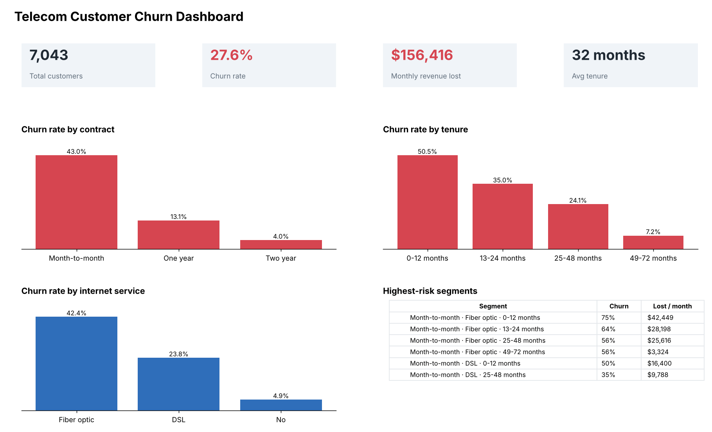

# Telecom Customer Churn Analysis Dashboard

An end-to-end analysis of **7,043 telecom customer records** to find out **why customers leave, how much revenue is being lost, and which current customers are most likely to leave next**, delivered as an interactive **Power BI dashboard** with retention recommendations.

**Tech stack:** Python (pandas, scikit-learn, matplotlib) · SQL (MySQL / SQLite) · Power BI (DAX) · MS Excel


*Preview generated with Python. The interactive dashboard is built in Power BI (see `powerbi/`).*

## Business questions

1. What is the overall churn rate and how much monthly revenue does it cost?
2. Which factors drive churn: contract, tenure, internet service, payment method, support add-ons?
3. Which customer segments have the highest churn and lose the most revenue?
4. Which **active** customers are at high risk and should be contacted first?

## Key findings

| Metric | Result |
|---|---|
| Customers analysed | 7,043 |
| Churn rate | **27.6%** (1,942 customers) |
| Monthly revenue lost to churn | **$156,416** (33.2% of monthly revenue) |
| Month-to-month vs two-year contract churn | **43.0% vs 4.0%** |
| Churn in the first 12 months | **50.5%**, falling to 7.2% after 4 years |
| Fiber optic churn | **42.4%** (vs 23.8% DSL) |
| Electronic check churn | **33.0%** (vs ~25% for other payment methods) |
| Highest-risk segment | Month-to-month · Fiber optic · 0-12 months: **75% churn** |
| Active customers flagged high-risk | **647**, worth **$54,339 / month** |

- **Contracts:** month-to-month customers produce **86.5% of the lost revenue**.
- **Early life:** half of new customers leave in their first year, so onboarding is where churn is won or lost.
- **Price sensitivity:** customers who left paid **$80.54/month on average vs $61.81** for those who stayed. Premium-band customers (>$90) churn at 43%.
- **Support add-ons:** internet customers without Tech Support or Online Security churn at 38.5%, vs 31.1% with them.

## Recommendations

1. **Contract migration:** offer month-to-month customers a discount or bonus to move to a 1- or 2-year contract, starting with fiber customers.
2. **First-year onboarding programme:** welcome calls and check-ins in months 1, 3 and 6 for new customers.
3. **AutoPay incentive:** a small discount for switching from electronic check to automatic payment.
4. **Bundle support add-ons:** include Tech Support / Online Security free for the first 6 months for fiber customers.
5. **Proactive retention calls:** the retention team works through the high-risk customer list (`data/processed/active_customer_risk.csv`), highest risk score first.

## Approach

```
Raw CSV ──► Python (pandas) cleaning ──► SQL analysis ──► Power BI dashboard
                     │                                    ▲
                     └──► churn risk model (scikit-learn) ┘
```

| Step | Tool | Script |
|---|---|---|
| 1. Data cleaning & feature engineering | Python, pandas | `scripts/clean_data.py` |
| 2. Churn risk scoring of active customers | scikit-learn Logistic Regression (ROC-AUC 0.86) | `scripts/clean_data.py` |
| 3. Analysis (11 queries: KPIs, churn drivers, revenue at risk, segment ranking with window functions) | SQL (MySQL / SQLite) | `sql/analysis_queries.sql`, `scripts/run_sql_analysis.py` |
| 4. Charts and dashboard preview | matplotlib | `scripts/make_charts.py` |
| 5. Interactive dashboard (3 pages, DAX measures, slicers, heat map) | Power BI | `powerbi/` |

**Data cleaning:** converted `TotalCharges` from text to numbers (11 blank values for brand-new customers set to 0), standardised Yes/No fields, checked for duplicate customer IDs, and added analysis columns: `TenureGroup`, `ChargeBand`, `AddOnServices`, `HasSupportAddOns`, `AutoPay`, `ChurnFlag` and `MonthlyRevenueLost`.

## Project structure

```
telecom-churn-analysis/
├── data/
│   ├── raw/telco_customer_churn.csv          # 7,043 customers, 21 columns
│   └── processed/
│       ├── customers_clean.csv               # cleaned data + analysis columns
│       ├── active_customer_risk.csv          # risk score for every active customer
│       └── churn_powerbi.xlsx                # Power BI data source
├── scripts/
│   ├── generate_data.py
│   ├── clean_data.py
│   ├── run_sql_analysis.py
│   ├── make_charts.py
│   └── export_powerbi.py
├── sql/
│   ├── schema.sql                            # MySQL table
│   └── analysis_queries.sql                  # all analysis queries
├── results/                                  # each SQL query's output as CSV + model metrics
├── reports/
│   ├── dashboard_preview.png
│   └── charts/
├── powerbi/
│   ├── DAX_measures.md
│   └── dashboard_build_guide.md
├── tests/test_pipeline.py                    # 8 tests: cleaning, SQL, risk model
├── run_all.py
└── requirements.txt
```

## How to run

```bash
python3 -m venv venv
source venv/bin/activate          # Windows: venv\Scripts\activate
pip install -r requirements.txt
python run_all.py                 # runs all 5 steps (about 10 seconds)
```

Then open `data/processed/churn_powerbi.xlsx` in Power BI and follow `powerbi/dashboard_build_guide.md`.

Run the tests (they check the cleaning, every SQL query and the risk model):

```bash
python -m pytest -v
```

## About the dataset

The data follows the column structure of the public **IBM Telco Customer Churn** sample dataset (customer demographics, services, contract, billing and churn). The included file is generated by `scripts/generate_data.py` with realistic churn behaviour. To run the analysis on the original IBM/Kaggle file instead, save it as `data/raw/telco_customer_churn.csv` and run every step except `generate_data.py`; the cleaning, SQL and dashboard work unchanged.

## Author

**Segu Gopi Trishank**, B.Tech Computer Science, KL University (2027)
GitHub: [trishank3146](https://github.com/trishank3146) · Email: segugopi@gmail.com
